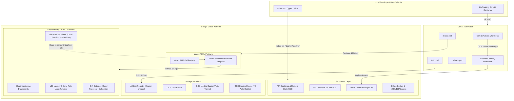

# MLOps-in-a-Box Architecture

MLOps-in-a-Box provides an enterprise-ready, modular foundation for deploying, serving, monitoring, and retiring machine learning models on Google Cloud Vertex AI using Infrastructure as Code (Terraform) and GitHub Actions.

---

## 1. High-Level Architecture



---

## 2. Core Architectural Pillars

### A. Zero Long-Lived Credentials
- Traditional setups rely on long-lived Google Service Account JSON keys downloaded to local machines or committed to CI secrets, representing a major vulnerability vector.
- MLOps-in-a-Box enforces **Workload Identity Federation (WIF)**. GitHub Actions exchanges an OpenID Connect (OIDC) token for short-lived Google Cloud credentials.
- Local workflows rely on Google Application Default Credentials (`gcloud auth application-default login`).

### B. Modular, Composability-First Design
Every module under `modules/` is decoupled:
- **`bootstrap`**: Enables all necessary GCP APIs with idempotent activation and sets up encrypted remote state storage.
- **`network`**: Creates a dedicated VPC with Private Google Access and Cloud NAT so compute resources need no public IP addresses.
- **`iam`**: Implements least-privilege service accounts (`vertex-sa` and `cicd-sa`).
- **`registry`**: Configures Docker repositories in Artifact Registry with automated cleanup policies for untagged images.
- **`storage`**: Deploys three distinct storage tiers:
  - Training Data (versioned)
  - Models (versioned, transitions to Nearline after 90 days)
  - Ephemeral Staging (auto-deletes after 7 days)
- **`vertex-endpoint`**: Provisions managed online prediction endpoints.
- **`monitoring`**: Configures observability dashboards, p99 latency alerts, statistical feature drift checks, and idle auto-shutdown.
- **`budget`**: Protects against unexpected cloud bills.

### C. Proactive Cost Guardrails
Machine learning endpoints running on cloud GPUs or VMs can incur high costs if left idle. MLOps-in-a-Box mitigates this via three layers:
1. **Budget Threshold Alerts:** Notifications at 50%, 80%, and 100% of budgeted spend.
2. **Idle Resource Auto-Shutdown:** A scheduled serverless function inspects prediction volume over the last 2 hours. If request volume is 0, the endpoint models are automatically undeployed.
3. **One-Command Cleanup:** Running `mlbox destroy` or `terraform destroy` completely tears down resources without orphan state.

---

## 3. Serving & Prediction Protocol

The prediction container exposes standard Vertex AI HTTP routes:
- `GET /health`: Health check returning HTTP 200 when ready to receive traffic.
- `POST /predict`: Batch and single-instance prediction route accepting:
  ```json
  {
    "instances": [
      [5.1, 3.5, 1.4, 0.2]
    ]
  }
  ```
  and returning class predictions with probability distributions.

